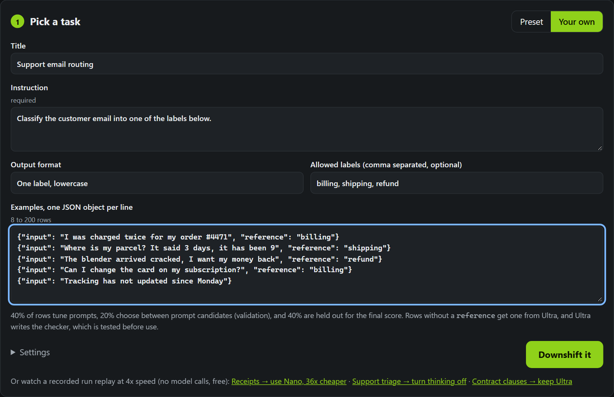

# Downshift: prove a cheaper Nemotron is enough

Give it a task and a few dozen examples. Downshift finds the cheapest NVIDIA Nemotron model on Nebius Token
Factory that does the task as well as Nemotron Ultra, and proves it on held-out data. It measures every step,
rewrites the prompt where that helps, and recommends fine-tuning only when prompting runs out of room.

The result is a verdict you can paste into code: the model, whether to turn thinking on, the final prompt, the
held-out score with a 95% confidence interval next to Ultra's, the cost per 1,000 calls, and the median latency.
**Every number comes from real Token Factory calls graded in Nebius Sandboxes. Nothing is mocked or simulated.**

## For judges: two minutes

- **Live app:** https://downshift-qcuv.onrender.com (pick a preset and press "Downshift it": about 2 to 3 minutes
  and US$0.06 to US$0.21 of real calls, or open a recorded run below).
- **Recorded runs, replayed at 4x with no model calls:**
  [receipts → use Nano](https://downshift-qcuv.onrender.com/?run=45015b6df59e&speed=4) ·
  [receipt photos → Super VL beats Ultra with no OCR](https://downshift-qcuv.onrender.com/?run=2e794b56ae40&speed=4) ·
  [support triage → turn thinking off](https://downshift-qcuv.onrender.com/?run=de04430645fb&speed=4) ·
  [contract clauses → keep Ultra](https://downshift-qcuv.onrender.com/?run=7ee9b72d56be&speed=4)
- **Results:** [RESULTS.md](RESULTS.md). Every figure traces to a file in `demo_runs/` or `presets/*/reference.json`.
- **Reproduce the headline yourself** (needs a Nebius key, about US$0.03):
  `python scripts/repeat_verdict.py demo_runs/45015b6df59e.json --repeats 3`

## What it found

| Task (held-out rows) | Verdict | Quality vs Ultra | Cost per 1k calls |
|---|---|---|---|
| Receipt OCR to JSON (86) | **Use Nemotron 3 Nano, thinking off** | 92.4% vs 92.0%, both 3-run means; paired diff +0.5 pts (95% CI −2.6 to +3.6) | $0.103 vs $3.693, **36x cheaper** |
| Bank support triage, 77 intents (150) | **Keep Ultra, turn thinking off** | 71.6% vs 72.2%, −0.7 pts (−4.7 to +3.6) | $0.554 vs $1.319, 2.4x cheaper |
| Contract clauses, 32 types (150) | **Keep Ultra** | best smaller model −6.2 pts (95% CI −12.4 to +0.0) | none |

And one finding we did not expect: **on all three tasks, Ultra's thinking mode cost 2.4x to 6.6x more per call, and
its accuracy gain was not distinguishable from zero** (paired 95% CIs of on minus off all include zero, 3 runs per
mode).

**Then I ran it on my own bot.** My hackathon judge bot (Claude Sonnet today) scores lablab submissions to predict
winners. On 105 real submissions, scored against the real judges, Downshift first said "use Nano, matches Ultra,
15x cheaper". True, and empty: **a fixed answer of 3 on every criterion beat every model** on that checker (75.4% vs
Ultra 72.1%, Sonnet 74.1%). So Downshift now runs a **guess check** before spending anything: if Ultra can't
provably beat a fixed answer, the checker can't tell skill from guessing and there is **no verdict**. On the three
presets the check passes by 48 to 79 points; on my bot it trips, in 27 s for US$0.00
([details](RESULTS.md#customer-test-my-own-hackathon-judge-bot-and-the-guess-check-it-forced)).

And a follow-up: **does the receipt pipeline even need its OCR step?** Nemotron 3.5 Super VL reading the photo
directly scored 93.6% with a plain prompt and **96.0% with Downshift's tuned prompt, +4.0 pts over Ultra reading
perfect OCR text (95% CI +1.2 to +7.3)**, at $0.72 per 1k calls, 3 runs each
([details](RESULTS.md#do-you-even-need-the-ocr-step-nemotron-super-vl-reads-the-photo-demo_runsvision-receipt-extractjson)).
This is now a step in the app: for a task that ships its photos, a **photo check** runs after the verdict and puts
Super VL on the ladder as a "reads the photo" rung. In the recorded run above it scored 95.2%, +3.2 pts over Ultra
(95% CI +0.3 to +6.4), in one pass with that run's own tuned prompt.

A whole ladder run costs cents: the receipts run was 606 model calls, US$0.06 and 139 seconds.

## Why not a model router?

Routers pick a model per request from heuristics or a learned predictor. Downshift answers a different question,
once per task: *is a cheaper model provably good enough for this job?* It measures that on held-out rows with a
non-inferiority rule (the 95% CI of the difference must stay within 5 points of Ultra), tunes the prompt for the
cheaper model first, says "keep Ultra" when the evidence is not there, and hands you the config to ship.

## Bring your own task



Open the **Your own** tab, describe the task, and paste 8 to 200 examples as JSON lines. Rows without a `reference`
get one from Ultra. Ultra also writes the checker (a Python `check(output, reference, input)` returning 0 to 1),
which is tested before use: references must score about 1.0 and deliberately wrong answers must score low, or it
falls back to exact match. The checker runs in Nebius Sandboxes with networking off. The same task can be sent to
`POST /api/run` as `{"custom": {...}}` (see API below).

To add a permanent preset with a hand-written checker, copy a folder in `presets/` (it holds `task.json`,
`train/validation/holdout.jsonl` and `checker.py`), then cache its Ultra reference with
`python scripts/measure_reference.py <slug>`.

## Run it on your own traffic (CLI)

Point it at a JSONL export of real requests. Each line is either a plain example, `{"input": ..., "reference": ...}`,
or an OpenAI-style chat log, `{"messages": [...], "response": ...}`: the last user message becomes the input and the
logged answer (from `response`, `output`, `completion`, or a trailing assistant message) becomes the reference that
cheaper models are graded against. Rows without an answer get one from Ultra.

```bash
python -m downshift.cli examples/support_logs.jsonl   --instruction "Route the customer email to one queue."   --labels billing,shipping,refund,account --output-format "One label, lowercase"   --cap 0.25 --calls-per-month 1000000 --json verdict.json
```

Progress streams to stderr. The verdict prints the model and thinking flag to use, the held-out score with its 95%
CI next to Ultra's, cost per 1k calls, and the monthly and yearly saving at your volume; `--json` also saves the
final prompt and a ready-to-paste Token Factory snippet. The run is a custom task (40% tuning, 20% validation, 40%
held out) with Ultra measured live, so it obeys the same spend cap and grading in Nebius Sandboxes as the web app.

`examples/support_logs.jsonl` is **synthetic**: 40 made-up support emails we wrote to show both input formats, not
real customer data. Use real logs, and use enough of them: 8 to 200 rows are accepted, but the confidence interval
is only informative with a sizeable held-out split (we used 86 to 150 held-out rows per preset; with 40 rows there are
only 16). A 20-row smoke test on this file cost US$0.009.

## How it works

1. **Reference.** If your examples have no expected outputs, Nemotron Ultra writes them.
2. **Grader.** Each preset ships a `checker.py`. For a custom task, Ultra writes one. Before a checker is trusted it
   is tested: the reference answers must score about 1.0, and deliberately wrong answers must score low. If it fails,
   Ultra gets one retry with the failure; after that Downshift falls back to exact match. Checker code is model-written,
   so it runs in **Nebius Sandboxes** with networking off, not on the web server.
3. **Three splits.** Tuning rows: the optimiser sees their failures and may use them as few-shot examples.
   Validation rows: used only to choose between prompt candidates, never shown to the optimiser. Held-out rows:
   scored once per rung, with the one prompt chosen on validation.
4. **Reference.** `scripts/measure_reference.py` runs Ultra on the full held-out split with thinking off and on,
   3 times each, and caches per-run scores, per-row scores and outputs, cost, latency, date and model ids in
   `presets/<slug>/reference.json`. Runs use it by default; the UI shows "Ultra reference measured on <date>, 3 runs,
   mean X ± spread". The reference is Ultra with thinking on unless thinking off scores higher. A setting re-measures
   Ultra live instead (one pass), and the engine falls back to live automatically if the cached file no longer
   matches the prompt or the held-out rows.
5. **Ladder.** Each rung is a model and a thinking mode, in order of measured cost per call: Lightning, Nano and
   Super with thinking off, then Lightning with thinking on (its reasoning tokens make it dearer per call than
   Super). Rungs are measured only when the run reaches them. On each rung:
   - score the plain prompt on the tuning and validation rows;
   - unless it already reaches Ultra's validation score, Ultra proposes rewritten prompts (new instructions plus
     few-shot examples picked from the tuning rows). Each candidate is scored on the tuning rows it did not use as
     examples and on the validation rows; the best **validation** score wins;
   - the winner is scored **once** on the held-out rows, and compared with Ultra on the same rows.
6. **Statistics and verdict.** Held-out scores carry a 95% bootstrap CI over rows (fixed seed). The comparison with
   Ultra is a paired bootstrap of the difference on the same rows.
   **Matches = the 95% CI of the difference stays within 5 points of Ultra** (its lower bound is above −5 points).
   The verdict says "better than Ultra" only if the whole CI is above 0. The tolerance is adjustable per run.
   The first rung that matches is the answer and the rungs above it are never called. If no smaller model matches
   and Ultra with thinking off matches Ultra with thinking on, the verdict is "turn thinking off: same quality,
   Nx cheaper". The verdict shows tuning, validation and held-out scores side by side, so any overfitting is visible.

   *Why 5 points:* at 150 held-out rows the measured paired 95% CI is about ±4 points for two near-identical models
   (Ultra with thinking off vs on) and about ±6 points for a small model vs Ultra. With 3 points nothing can pass,
   not even Ultra against itself with thinking toggled (lower bounds −4.7, −4.9 and −5.6 on the three tasks).
   5 points is about the smallest tolerance a model that agrees with Ultra can pass at this sample size; it is still
   strict (a small model averaging the same as Ultra but disagreeing on many rows fails). See RESULTS.md.
7. **Fine-tune fallback.** When no rung matches, Downshift can build a chat dataset from the tuning rows' reference
   answers and launch a Token Factory fine-tune job (Qwen3-4B by default; Token Factory does not fine-tune
   Nemotron). It is off unless `DOWNSHIFT_ALLOW_FINETUNE=1`, and serving the result needs Token Factory's
   custom-weights access.

A hard per-run spend cap (US$0.25 by default; the server also clamps each run to `DOWNSHIFT_MAX_RUN_CAP_USD` and
stops at `DOWNSHIFT_SERVER_CAP_USD` per process) stops the run cleanly. Before each step the engine estimates its
cost, skips a rung that would not fit, and stops tuning early with a verdict rather than running out mid-step. With
the cached reference a preset run cost US$0.06 to US$0.21 and took 139 to 182 seconds (measured, see RESULTS.md).

## Where each Nebius / NVIDIA piece is used

| Piece | Used for |
|---|---|
| NVIDIA Nemotron 3.5 Lightning, Nemotron 3 Nano 30B, Super 120B, Ultra 550B | The ladder. Ultra also writes references, checkers and prompt rewrites. |
| Nebius Token Factory (OpenAI-compatible API, `https://api.tokenfactory.nebius.com/v1`) | Every model call. Live prices come from `GET /v1/models?verbose=true`. Thinking is toggled with `extra_body={"chat_template_kwargs": {"enable_thinking": ...}}`. |
| Nebius Sandboxes | Runs checker code on each batch of outputs (one sandbox operation per batch, networking disabled). The UI shows which backend graded each run and says "graded locally" if Sandboxes were unavailable. |
| Token Factory fine-tuning | The fallback when prompting tops out. |

## Presets

| Slug | Task | Source |
|---|---|---|
| `support-triage` | Route bank support messages to one of 77 intents | Banking77 (PolyAI), CC-BY-4.0 |
| `receipt-extract` | Turn OCR'd receipt text into JSON line items and totals | CORD v2 (NAVER Clova), CC-BY-4.0 |
| `contract-clauses` | Tag contract clauses with one of 32 types | CUAD (The Atticus Project), CC-BY-4.0 |

Each has 60 tuning, 40 validation and 150 held-out rows (receipt-extract: 49 / 40 / 86, the size of CORD's usable
test split), plus a cached Ultra reference. See `presets/README.md` for how they were built.

## Results

See **[RESULTS.md](RESULTS.md)**: the ladder for each task with 95% CIs, the verdicts, the overfit gaps, Ultra's own
run-to-run noise, the limits of the method, and what it all cost. Reproduce the tables with
`python scripts/results_tables.py demo_runs/*.json`; re-measure a reference with
`python scripts/measure_reference.py <slug>` (about US$0.9 to US$1.2 per preset).

## Setup

Python 3.11 or newer.

```bash
pip install -r requirements.txt
cp .env.example .env     # or create .env with the two lines below
# NEBIUS_API_KEY=...
# NEBIUS_PROJECT_ID=...   (for Sandboxes)
```

The key is read from the environment or `.env`. It is never logged, saved in runs, or sent into a sandbox.

## Run

```bash
python -m uvicorn app:app --port 8000
# open http://localhost:8000, pick a preset, press "Downshift it"
```

A finished run can be reopened at `/?run=<id>`. Runs are saved to `runs/<id>.json`; runs copied into `demo_runs/`
ship with the image so they stay viewable on a hosted copy.

API:

| Method | Path | |
|---|---|---|
| GET | `/api/health` | backend, `key_present`, Sandboxes info, pricing source |
| GET | `/api/presets` | preset list |
| POST | `/api/run` | `{"preset": "receipt-extract", "options": {"spend_cap_usd": 0.1}}` or `{"custom": {...}}`, returns a run id |
| GET | `/api/run/{id}/events` | server-sent events (replays a finished run; `?speed=4` paces it at 4x the recorded time) |
| GET | `/api/run/{id}` | saved run with verdict |

Options for `/api/run`: `spend_cap_usd`, `tolerance` (default 0.05), `rounds`, `candidates`, `thinking_rungs`,
`reference` (`"cached"` or `"live"`) and `ultra_thinking` (live reference only).

A custom task is `{"title", "instruction", "output_format", "label_set"?, "examples": [{"input", "reference"?}]}`
with 8 to 200 examples; 40% tune, 20% validate and 40% are held out. Custom tasks have no cached reference, so Ultra
is measured live.

## Tests

```bash
python -m pytest            # engine, grader and server tests, no network
python -m pytest -m live    # one live smoke test, costs about US$0.02
```

## Deploy

```bash
docker build -t downshift .
docker run -p 8000:8000 -e NEBIUS_API_KEY=... -e NEBIUS_PROJECT_ID=... downshift
```

The container listens on `$PORT` (default 8000), so it runs as-is on Render, Fly or similar. Set the two secrets in the
host's settings. Useful limits for a public demo: `DOWNSHIFT_MAX_ACTIVE_RUNS` (default 2),
`DOWNSHIFT_MAX_RUN_CAP_USD` (default 0.50), `DOWNSHIFT_SERVER_CAP_USD` (default 5.00 per process).

## Layout

```
app.py                  FastAPI server and SSE
downshift/models.py     rungs, pricing, Token Factory client, per-call accounting (runs/usage.jsonl)
downshift/engine.py     the pipeline, as an async generator of events
downshift/stats.py      bootstrap CIs and the paired comparison
downshift/grading.py    Sandboxes grader with labelled local fallback
downshift/sandbox_grader.py  Nebius Sandboxes harness
downshift/finetune.py   dataset builder and fine-tune job launcher
downshift/cli.py        run Downshift on your own logged traffic (JSONL)
downshift/tasks.py      presets, custom tasks, prompt assembly
static/                 single-page UI, no build step
presets/                three benchmark tasks: splits, checkers, cached Ultra references
scripts/                build_presets, measure_reference, run_presets, results_tables, repeat_verdict
```

## Licence

MIT.
